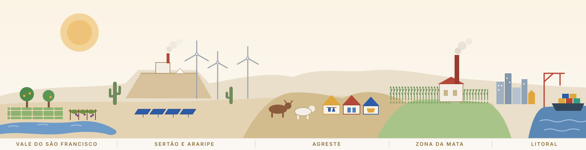

```{r}
#| include: false
source("_setup.R")
lt <- readr::read_csv(file.path(Sys.getenv("PASTA_PROJETO"), "config", "linha_do_tempo.csv"),
                      col_types = readr::cols(.default = "c"), na = "")
lt[is.na(lt)] <- ""
perfil <- tryCatch(ler_base("perfil_cad"), error = function(e) NULL)
n_marcos <- sum(lt$tipo %in% c("marco", "fator", "previsto"))
n_ativ <- sum(lt$tipo == "trilha")
anos_hist <- as.integer(format(Sys.Date(), "%Y")) - 1535

# Cartão "o que ficou hoje": vínculos formais da cadeia no último ano da RAIS e a série desde 2006
cartao_hoje <- function(ids) {
  if (is.null(perfil) || !NROW(perfil)) return(NULL)
  meta <- cad$meta
  cards <- lapply(ids, function(id) {
    s <- perfil %>% dplyr::filter(cadeia_id == !!id) %>% dplyr::arrange(ano)
    if (!nrow(s)) return(NULL)
    u <- s[nrow(s), ]; p <- s[1, ]
    var <- if (p$vinculos > 0) 100 * (u$vinculos / p$vinculos - 1) else NA
    # minigráfico: uma série só, sem legenda; cada ponto com o valor no hover
    w <- 120; h <- 36; xs <- scales::rescale(s$ano, c(4, w - 4)); ys <- scales::rescale(s$vinculos, c(h - 4, 4))
    if (length(unique(s$vinculos)) == 1) ys <- rep(h / 2, nrow(s))
    pts <- paste(sprintf("%.1f,%.1f", xs, ys), collapse = " ")
    dots <- paste(sprintf('<circle cx="%.1f" cy="%.1f" r="6" fill="transparent"><title>%s: %s vínculos</title></circle>',
                          xs, ys, s$ano, fmt_num(s$vinculos)), collapse = "")
    spark <- sprintf('<svg width="%d" height="%d" aria-hidden="true"><polyline points="%s" fill="none" stroke="#2B2620" stroke-width="2" stroke-linejoin="round"/><circle cx="%.1f" cy="%.1f" r="3.5" fill="#2B2620"/>%s</svg>',
                     w, h, pts, xs[length(xs)], ys[length(ys)], dots)
    nome <- meta$cadeia[match(id, meta$cadeia_id)]
    htmltools::a(class = "h-cartao", href = paste0("cadeias/", id, ".html"),
      htmltools::HTML(spark),
      htmltools::div(
        htmltools::div(class = "h-cad", paste0(nome, ", hoje")),
        htmltools::div(class = "h-val", paste0(fmt_num(u$vinculos), " vínculos")),
        htmltools::div(class = "h-var", paste0("RAIS ", u$ano, if (!is.na(var)) paste0(" · ", ifelse(var >= 0, "+", ""), fmt_num(var, 0), "% desde ", p$ano) else ""))))
  })
  htmltools::div(class = "h-hoje", cards)
}
```

::: {.h-hero}
::: {.h-sobre}
História econômica · Pernambuco
:::

# Pernambuco em ciclos {.unnumbered .unlisted}

::: {.h-lead}
O açúcar fez a capitania, o gado e o algodão abriram o interior, as fábricas trouxeram a cidade operária, e o século XX acrescentou fruta irrigada, jeans, gesso, porto, refinaria, carro e código. Cada ciclo subiu, caiu ou mudou de forma por razões parecidas: preço lá fora, seca, decisão em Brasília, estrada e porto, gente para trabalhar. Esta página conta essa história em capítulos curtos e mostra o que ficou de cada ciclo nos dados de hoje.
:::

```{r}
#| results: asis
#| echo: false
cat(sprintf('<div class="h-numeros"><div><b>%d</b><span>anos desde Duarte Coelho</span></div><div><b>%d</b><span>atividades na linha do tempo</span></div><div><b>%d</b><span>marcos e fatores, cada um com fonte</span></div></div>', anos_hist, n_ativ, n_marcos))
```

{.h-panorama fig-alt="Ilustração de Pernambuco de oeste a leste: fruta irrigada e vinhedos no São Francisco, mandacarus, gesso, vento e sol no Sertão e no Araripe, gado, feira e confecção no Agreste, cana e usina na Mata, cidade, porto e mar no litoral."}
:::

## A linha do tempo {.unnumbered}

::: {.h-corpo}
Cada faixa é uma atividade. A cor diz em que fase ela estava: surgindo, no auge, em declínio ou se refazendo. Os pontos são marcos; passe o mouse para ler e clique para fixar e abrir a fonte. O nome da atividade leva ao capítulo. A escala do tempo muda de ritmo nas linhas pontilhadas: os séculos coloniais aparecem comprimidos para dar espaço ao que aconteceu depois de 1850. Depois da linha de hoje, os círculos tracejados são o que já está contratado ou previsto.
:::

```{r}
#| results: asis
cat('<script type="application/json" id="dados-linha">', jsonlite::toJSON(lt, dataframe = "rows", auto_unbox = TRUE), '</script>\n', sep = "")
```

```{=html}
<div class="linha-tempo column-page">
  <div class="lt-controles">
    <div class="lt-legenda">
      <span><i class="lt-sw" style="background:#2FA084"></i>Surgimento</span>
      <span><i class="lt-sw" style="background:#E0A63C"></i>Auge</span>
      <span><i class="lt-sw" style="background:#B4493A"></i>Declínio</span>
      <span><i class="lt-sw" style="background:#2C5BA8"></i>Retomada</span>
      <span><i class="lt-sw aprox"></i>Início aproximado</span>
      <span><i class="lt-sw marco"></i>Marco</span>
      <span><i class="lt-sw prev"></i>Previsto</span>
    </div>
    <label><input type="checkbox" id="lt-fatores" checked> Mostrar fatores transversais</label>
  </div>
  <div class="lt-tela"></div>
  <div class="lt-dica" role="tooltip"></div>
  <div class="lt-nota">Fases são leituras de conjunto, não datas exatas: quando o começo de um ciclo não tem data firme nas fontes, a faixa aparece esmaecida no início.</div>
</div>
```

::: {#acucar .h-capitulo}
::: {.h-kicker}
1535 a 1654 · Zona da Mata e Recife
:::

## [1]{.h-num} O açúcar que fez a capitania

Duarte Coelho chegou em 1535 com cana trazida da Ilha da Madeira e a ideia de que a terra molhada da várzea pagaria a aventura. Pagou. Nos primeiros anos já havia cerca de trinta engenhos, e Pernambuco se tornou o centro da economia açucareira da colônia. O engenho era fábrica, fazenda e vila ao mesmo tempo, e o trabalho era de africanos escravizados, porque a mão de obra indígena não bastava.

A riqueza atraiu os holandeses, que ficaram de 1630 a 1654. A guerra quebrou engenhos e, depois da expulsão, os próprios holandeses levaram a técnica para o Caribe, que virou concorrente. O açúcar nunca saiu da Mata, mas Pernambuco não voltou a ser o centro do mundo açucareiro.

::: {.h-ficha}
::: {.puxou}
**O que puxou**
Terra de massapê, crédito e mercado europeu, trabalho escravizado.
:::
::: {.derrubou}
**O que derrubou**
Guerra holandesa e a concorrência do açúcar do Caribe.
:::
::: {.ficou}
**O que ficou**
A Zona da Mata canavieira, o latifúndio e a cidade portuária do Recife.
:::
:::

```{r}
cartao_hoje("sucroenergetico")
```
:::

::: {#sertao .h-capitulo}
::: {.h-kicker}
1650 a 1983 · Agreste e Sertão
:::

## [2]{.h-num} Para dentro: gado e algodão

Enquanto a Mata plantava cana, o gado subia o rio e ocupava o interior, porque o boi anda sozinho até o comprador. Couro, carne e animais de tração abasteciam os engenhos. A seca de 1777 a 1780 mostrou o limite: na estiagem de 1778 o Nordeste perdeu sete de cada oito cabeças. O rebanho voltou, e no censo de 1872 o Brejo já tinha mais de 1.500 criadores.

O algodão chegou como resposta a uma fábrica do outro lado do oceano. A Revolução Industrial inglesa comprava toda a fibra que houvesse, e o interior de Pernambuco plantou. Quando os Estados Unidos dominaram o mercado, depois de 1830, o preço caiu; quando a Guerra de Secessão cortou o algodão americano, entre 1861 e 1865, voltou a subir. Na segunda metade do século XIX o algodão foi a força que movia o interior e ajudou a formar o próprio Agreste como região. O ciclo terminou em 1983, quando o bicudo chegou a Pernambuco e devastou lavouras pequenas e sem defesa.

::: {.h-ficha}
::: {.puxou}
**O que puxou**
Demanda das fábricas inglesas, guerras que tiravam o concorrente do mercado, terra barata no interior.
:::
::: {.derrubou}
**O que derrubou**
Secas, o algodão americano e, por fim, o bicudo.
:::
::: {.ficou}
**O que ficou**
A pecuária do Agreste, hoje bacia leiteira, e a rede de feiras e cidades do interior.
:::
:::

```{r}
cartao_hoje(c("bovinocultura", "cotonicultura"))
```
:::

::: {#usinas .h-capitulo}
::: {.h-kicker}
1875 a 1985 · Mata e Região Metropolitana
:::

## [3]{.h-num} Usinas e fábricas

Em 1875 a Usina São Francisco da Várzea fez a primeira moagem de uma usina no estado. O velho engenho banguê, que moía só a própria cana, foi dando lugar a usinas que compravam a cana de muitos engenhos e depois juntavam as terras. Pernambuco chegou a ter mais de cem usinas. Em 1933 o governo Vargas criou o Instituto do Açúcar e do Álcool, que por quase sessenta anos decidiu cotas e preços.

A outra face da modernização foi o tecido. Em 1891 nasceu em Paulista uma fábrica de sacaria; em 1904 Herman Lundgren a comprou e montou ali uma cidade-fábrica, com vila operária, comércio e controle sobre a vida dos trabalhadores. Por volta de 1950 Paulista tinha 7.785 operários, segundo município industrial do estado. Em 1958 a empresa estagnou, e a fábrica fechou em meados dos anos 1980.

::: {.h-ficha}
::: {.puxou}
**O que puxou**
Máquina a vapor, ferrovia e capital concentrado em poucas famílias.
:::
::: {.derrubou}
**O que derrubou**
Maquinário envelhecido e a concorrência das fábricas do Sudeste.
:::
::: {.ficou}
**O que ficou**
Usinas que ainda moem na Mata e a tradição têxtil, que migrou para o Agreste.
:::
:::
:::

::: {#planejamento .h-capitulo}
::: {.h-kicker}
1959 a 1990 · o estado inteiro
:::

## [4]{.h-num} O Estado entra em cena

Em 15 de dezembro de 1959 a Lei 3.692 criou a SUDENE, com sede no Recife e a tarefa de industrializar o Nordeste com incentivos. Foi a SUDENE, por exemplo, que financiou o reequipamento da fábrica de Paulista entre 1958 e 1963. Nos anos seguintes vieram outras decisões tomadas fora do estado e que mudaram o mapa dentro dele: a Codevasf, em 1974, com superintendência em Petrolina; o Proálcool, em 1975, resposta ao choque do petróleo, que deu à cana uma segunda vida; e, por lei estadual, o Complexo de Suape, em 1978.

Em 1990 a maré virou. O IAA foi extinto, preços e exportações de açúcar foram liberados, e a abertura comercial expôs indústrias que tinham crescido protegidas. Em 1998 e 1999 usinas tradicionais como a Central Barreiros pararam de moer.

::: {.h-citacao}
Boa parte dos ciclos de Pernambuco começou ou acabou com uma decisão tomada fora do estado.
:::
:::

::: {#vale .h-capitulo}
::: {.h-kicker}
1968 até hoje · Sertão do São Francisco
:::

## [5]{.h-num} O sertão que virou pomar

Em 1968 o Projeto Bebedouro, em Petrolina, dividiu 130 hectares de caatinga em 16 lotes irrigados. Era um teste. Em 1979 veio o Perímetro Senador Nilo Coelho, com 20 mil hectares entre Petrolina e Casa Nova, e em 1988 os produtores criaram a Valexport para vender fruta fresca lá fora: em quatro safras a exportação passou de 500 toneladas para 34 mil.

Manga e uva levaram o Vale para mercados de dezenas de países. Em 2022 os vinhos do Vale do São Francisco receberam a primeira indicação geográfica de vinhos tropicais do mundo, e em 2024 Pernambuco foi o estado que mais exportou fruta no Brasil. A água, que fez o ciclo, também é o risco: na seca de 2015 o reservatório de Sobradinho chegou a cerca de 1% do volume útil.

::: {.h-ficha}
::: {.puxou}
**O que puxou**
Água do São Francisco, perímetros públicos, sol o ano inteiro e organização dos produtores para exportar.
:::
::: {.derrubou}
**O que ameaça**
Secas longas, custo da energia e dependência de poucos mercados.
:::
::: {.ficou}
**O que ficou**
Petrolina como polo do Sertão e uma cadeia que vai do viveiro à câmara fria e ao porto.
:::
:::

```{r}
cartao_hoje(c("fruticultura", "vitivinicultura"))
```
:::

::: {#agreste .h-capitulo}
::: {.h-kicker}
1950 até hoje · Agreste e Araripe
:::

## [6]{.h-num} Feira, jeans e gesso

Em meados do século XX, em Santa Cruz do Capibaribe, retalhos de tecido viraram roupa vendida em feira: era a sulanca. Caruaru entrou nos anos 1970, Toritama em 1980, especializada em jeans. O polo cresceu quase sem plano e com muita informalidade, e ganhou endereço próprio: o centro de compras de Toritama em 2001, o Polo Caruaru em 2004 e o Moda Center, em Santa Cruz, em 2006, com cerca de 10 mil boxes e lojas. Em 2014 a RAIS contava 2.182 confecções formais no polo; o Sebrae estima mais de 100 mil pessoas na produção e na venda.

No extremo oeste, outro ciclo nasceu debaixo da terra. A gipsita do Araripe virou gesso em calcinadoras de Araripina, Trindade, Ipubi, Ouricuri e Bodocó. Em 1999 Pernambuco já produzia 87,6% da gipsita do país; hoje o polo responde por cerca de 95% do gesso nacional.

::: {.h-ficha}
::: {.puxou}
**O que puxou**
Feira como canal de venda, redes de família, matéria-prima local e baixo custo de entrada.
:::
::: {.derrubou}
**O que trava**
Informalidade, lenha da caatinga como energia e logística cara para chegar aos grandes mercados.
:::
::: {.ficou}
**O que ficou**
Santa Cruz e Toritama, onde a confecção é mais de 90% das indústrias formais, e o Araripe do gesso.
:::
:::

```{r}
cartao_hoje(c("textil_confeccoes", "gesso"))
```
:::

::: {#suape .h-capitulo}
::: {.h-kicker}
1978 até hoje · Litoral Sul e Mata Norte
:::

## [7]{.h-num} Porto, refinaria e carro

Suape foi fundado em 7 de novembro de 1978 e passou quase três décadas como promessa, até virar, nos anos 2000, o lugar do maior ciclo de investimento recente do estado. Em 2007 começaram as obras do Estaleiro Atlântico Sul, cujo primeiro navio, o João Cândido, encerrou mais de dez anos sem construção naval no país; em 2014 a Refinaria Abreu e Lima começou a operar, e o combustível passou a liderar as exportações do estado.

A crise da Petrobras e da indústria naval derrubou o ciclo: dos 22 navios encomendados ao estaleiro, 7 foram cancelados, e o quadro, que chegou a cerca de 7 mil funcionários, encolheu. A refinaria agora recebe nova rodada de investimento, de R$ 12 bilhões. No norte, em Goiana, a fábrica da Jeep começou a produzir em 2015 e passou de um milhão de veículos em 2023, trazendo fornecedores para uma região até então de cana.

::: {.h-ficha}
::: {.puxou}
**O que puxou**
Porto de águas profundas, investimento federal e de grandes empresas, incentivos fiscais.
:::
::: {.derrubou}
**O que derrubou**
Dependência de poucos compradores, crise na Petrobras e obras que não terminaram, como a Transnordestina.
:::
::: {.ficou}
**O que ficou**
Porto, refinaria e estaleiro em Suape, e um polo automotivo em Goiana.
:::
:::

```{r}
cartao_hoje(c("petroquimica_plasticos", "automotivo"))
```
:::

::: {#codigo .h-capitulo}
::: {.h-kicker}
2000 até hoje · Recife e Sertão
:::

## [8]{.h-num} Código e vento

Em 2000 o Recife Antigo, onde ficava o porto do tempo dos holandeses, virou Porto Digital, então um projeto incipiente. Vinte e cinco anos depois, são mais de 475 empresas e 21,5 mil empregos diretos. É o primeiro ciclo de Pernambuco que não depende de terra, água ou porto.

O mais novo é o do vento e do sol. Em 2015 entrou em operação em Tacaratu o primeiro parque híbrido do país, eólico e solar no mesmo lugar, ampliado em 2021. O Sertão, que por séculos foi lugar de seca, passa a vender energia.

::: {.h-ficha}
::: {.puxou}
**O que puxou**
Universidades, empresas reunidas no mesmo bairro, vento constante e sol forte.
:::
::: {.derrubou}
**O que trava**
Disputa por talentos com o resto do mundo e rede de transmissão para escoar energia.
:::
::: {.ficou}
**O que fica**
Duas cadeias novas, que ainda estão escrevendo o primeiro capítulo.
:::
:::

```{r}
cartao_hoje(c("ti_software", "bioeconomia_renovaveis"))
```
:::

::: {#hoje .h-capitulo}
::: {.h-kicker}
O que a história explica dos dados
:::

## [9]{.h-num} Ciclos que ficam no mapa

Quase nenhum ciclo de Pernambuco acabou de verdade: cada um deixou cidades, empresas e saberes que continuam no mapa das vocações. A cana segue na Mata, o leite no Agreste, a confecção no polo da sulanca, o gesso no Araripe, a fruta no Vale. O que muda é o peso de cada um e quem chega por cima. Para ver onde cada atividade está hoje, veja as [vocações por cadeia](vocacoes-cadeias.qmd), o [panorama](panorama.qmd) e as páginas de cada [cadeia e nicho](cadeias/index.qmd).
:::

::: {#futuro .h-capitulo}
::: {.h-kicker}
Daqui para a frente
:::

## [10]{.h-num} O que vem por aí

Os próximos ciclos vão depender dos mesmos fatores que fizeram e desfizeram os anteriores: água, energia, estrada e porto, tributo e gente. A diferença é que, desta vez, quase todos estão em obra ou em transição ao mesmo tempo. Abaixo, o que já está contratado ou previsto, e o que pesa contra cada aposta. As datas são as de quem executa e podem mudar.

::: {.h-futuro}
::: {.h-fut}
[Água · 2026]{.h-fut-tag}

#### O São Francisco chega ao Agreste

Hoje cerca de 900 mil pessoas em 10 cidades recebem água da transposição. A 1ª etapa da Adutora do Agreste deve chegar a 23 municípios e cerca de 1,3 milhão de pessoas até o fim de 2026. É a região da confecção e do leite, que cresceu com pouca água.

**O que pesa contra:** a 2ª etapa, para mais 45 municípios, ainda depende de recursos federais.

::: {.h-fut-fonte}
[Movimento Econômico, 08/2025](https://movimentoeconomico.com.br/geral/infraestrutura/2025/08/26/mais-de-900-mil-pessoas-recebem-agua-do-sao-francisco-em-pernambuco/); [Agência Gov, 01/2026](https://agenciagov.ebc.com.br/noticias/202601/adutora-do-agreste-avanca-e-transforma-abastecimento-de-agua-no-interior-de-pernambuco)
:::
:::

::: {.h-fut}
[Energia · 2026]{.h-fut-tag}

#### Vento e sol viram combustível

Suape recebe a primeira fábrica de e-metanol do país, da European Energy, com R$ 2 bilhões. O combustível é feito com energia renovável, e o vento e o sol do Sertão ganham um comprador industrial dentro do estado.

**O que pesa contra:** é um mercado novo, com preço e demanda internacionais ainda em formação.

::: {.h-fut-fonte}
[Movimento Econômico, 04/2024](https://movimentoeconomico.com.br/economia/energia/2024/04/12/pe-tera-1a-industria-de-e-metanol-do-brasil-com-investimento-de-r-2-bilhoes/)
:::
:::

::: {.h-fut}
[Refino · 2029]{.h-fut-tag}

#### A refinaria dobra de tamanho

Com o Trem 2, contratado por R$ 4,9 bilhões, a Abreu e Lima passa de 130 mil para 260 mil barris por dia e vira a segunda maior refinaria da Petrobras.

**O que pesa contra:** a transição energética encurta o horizonte do combustível fóssil.

::: {.h-fut-fonte}
[eixos, 06/2025](https://eixos.com.br/combustiveis-e-bioenergia/petrobras-assina-contrato-de-49-bilhoes-de-reais-com-consag-engenharia-para-construcao-do-trem-2-da-rnest/)
:::
:::

::: {.h-fut}
[Logística · sem data]{.h-fut-tag}

#### A Transnordestina em Pernambuco

O trecho Custódia-Arcoverde foi licitado e teve vencedora homologada em 2026. O Salgueiro-Suape, parado há mais de dez anos, segue sem data, à espera do TCU. É o trilho que ligaria o gesso do Araripe e o Sertão ao porto.

**O que pesa contra:** a obra começou em 2006, com entrega prevista para 2010.

::: {.h-fut-fonte}
[Diario de Pernambuco, 10/2025](https://www.diariodepernambuco.com.br/economia/2025/10/11699452-transnordestina-tem-edital-de-licitacao-publicado-entenda-a-historia-da-ferrovia.html); [Movimento Econômico, 07/2026](https://movimentoeconomico.com.br/geral/infraestrutura/transnordestina/2026/07/03/ferrovia-salgueiro-suape-segue-sem-data-para-retomada-das-obras/)
:::
:::

::: {.h-fut}
[Tributo · 2027 a 2033]{.h-fut-tag}

#### O fim da guerra fiscal

A reforma tributária acaba com os incentivos de ICMS até 2033, e a cobrança passa para o destino, o que favorece estados consumidores como Pernambuco. Atrair empresas vai depender mais de infraestrutura, segurança jurídica e inovação do que de desconto de imposto.

**O que pesa contra:** dois sistemas convivendo até 2033, com risco de disputa sobre créditos e benefícios.

::: {.h-fut-fonte}
[Movimento Econômico, 07/2026](https://movimentoeconomico.com.br/geral/redacao/2026/07/30/reforma-tributaria-pernambuco-cria-duas-frentes-para-a-transicao/)
:::
:::

::: {.h-fut}
[Gente · contínuo]{.h-fut-tag}

#### O ciclo que depende de cabeça

Aos 25 anos, o Porto Digital passa de 475 empresas e 21,5 mil empregos diretos. É o primeiro ciclo do estado em que o insumo principal é gente formada, e não terra, água ou porto.

**O que pesa contra:** a disputa por talentos agora é com o mundo inteiro, no trabalho remoto.

::: {.h-fut-fonte}
[Movimento Econômico, 12/2025](https://movimentoeconomico.com.br/tecnologia/2025/12/12/porto-digital-25-anos-hub-de-tecnologia-e-talentos-transforma-economia-do-ne/)
:::
:::
:::

::: {.h-citacao}
Se a história serve de guia, o próximo ciclo vai nascer onde água, energia e logística chegarem primeiro.
:::
:::

::: {#leituras .h-capitulo}
## Para ir mais fundo {.unnumbered}

::: {.h-leituras}
- **Celso Furtado, *Formação Econômica do Brasil* (1959).** A economia do açúcar, a pecuária como extensão dela e a concorrência das Antilhas.
- **Caio Prado Jr., *História Econômica do Brasil* (1945).** O renascimento agrícola do fim do século XVIII, com o algodão, e a economia do Império.
- **Manuel Correia de Andrade, *A Terra e o Homem no Nordeste* (1963).** Mata, Agreste e Sertão: cana, gado e algodão, região por região.
- **Evaldo Cabral de Mello, *Olinda Restaurada* (1975) e *O Norte Agrário e o Império* (1984).** A guerra holandesa e o açúcar; o Norte perdendo escravizados e poder para o café.
- **Peter Eisenberg, *Modernização sem mudança* (1977).** Engenhos centrais, usinas, ferrovia e abolição no açúcar de Pernambuco, de 1840 a 1910.
- **Francisco de Oliveira, *Elegia para uma re(li)gião* (1977).** A SUDENE, o planejamento e os conflitos do Nordeste.
- **Gadiel Perruci, *A República das Usinas* (1978).** O açúcar pernambucano na Primeira República.
:::
:::

::: {.h-capitulo}
## Os marcos em tabela {.unnumbered}

<details><summary>Ver todos os marcos e fatores, com as fontes</summary>

```{r}
trilhas <- lt %>% dplyr::filter(tipo %in% c("trilha", "trilha_fator")) %>% dplyr::select(trilha, nome = titulo)
tab <- lt %>% dplyr::filter(tipo %in% c("marco", "fator", "previsto")) %>%
  dplyr::left_join(trilhas, by = "trilha") %>%
  dplyr::mutate(ano = as.integer(inicio), Quando = ifelse(tipo == "previsto", paste(inicio, "(previsto)"), ifelse(fim != "", paste(inicio, "a", fim), inicio)),
                Fonte = purrr::map2_chr(fonte, link, function(f, l) {
                  fs <- strsplit(f, " | ", fixed = TRUE)[[1]]; ls <- strsplit(l, " | ", fixed = TRUE)[[1]]
                  paste(ifelse(nzchar(ls[seq_along(fs)]) & !is.na(ls[seq_along(fs)]),
                               sprintf('<a href="%s" target="_blank" rel="noopener">%s</a>', ls[seq_along(fs)], htmltools::htmlEscape(fs)), htmltools::htmlEscape(fs)), collapse = "; ")
                })) %>%
  dplyr::arrange(ano) %>%
  dplyr::transmute(Quando, Onde = nome, Marco = paste0("<b>", htmltools::htmlEscape(titulo), "</b>. ", htmltools::htmlEscape(descricao)), Fonte)
htmltools::HTML(knitr::kable(tab, format = "html", escape = FALSE, table.attr = "class='table table-sm h-fontes'"))
```

</details>

<p class="fonte">Baixe o texto completo em <a href="imagens/Historia_Economica_PE.docx" download>Word</a>. Os marcos e as fases estão em `config/linha_do_tempo.csv`, com a fonte de cada um. Os números de "hoje" vêm da RAIS, pelo mesmo recorte de cadeias do resto do painel.</p>
:::
