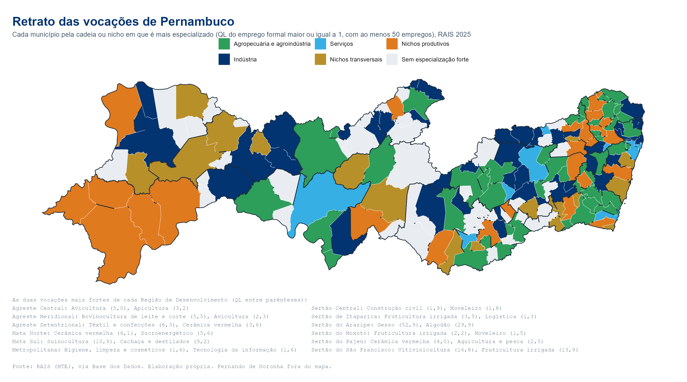

As cadeias e nichos do painel cobrem as atividades mais importantes do estado, mas não todas. Esta página mede **todas as subclasses da CNAE com emprego formal em Pernambuco**, para responder duas perguntas: em que um município ou região é especializado, e onde está uma atividade qualquer. A medida é o quociente locacional (QL) do emprego formal: o peso da atividade no território dividido pelo peso dela no estado. Acima de 1, o território é especializado.

{.retrato}

<p class="fonte">Baixe o retrato em <a href="imagens/retrato_vocacoes.png" download>PNG</a> ou <a href="imagens/retrato_vocacoes.pdf" download>PDF</a>.</p>

```{ojs}
//| echo: false
V = FileAttachment("dados/vocacoes.json").json()
geo = FileAttachment("dados/malha_pe.geojson").json()
PROD = FileAttachment("dados/producao.json").json()
tabProd = (linhas, n = 15, total = null) => {
  if (!linhas || !linhas.length) return html`<p>Sem produção agropecuária registrada pelo IBGE.</p>`;
  const PR = PROD.produtos;
  const t = linhas.map(([p, v, q, ql]) => ({p, nome: PR.nome[p], grupo: PR.grupo[p], v, q, ql, un: PR.unidade[p], part: PR.valor[p] ? v / PR.valor[p] : null}))
    .filter(d => d.v > 0).sort((a, b) => b.v - a.v);
  const tot = d3.sum(t, d => d.v);
  return html`<p>Valor da produção agropecuária e da aquicultura: <b>${reaisMil(tot)}</b>${total ? html`, ${(100 * tot / total).toLocaleString("pt-BR", {maximumFractionDigits: 1})}% do estado` : ""} (IBGE ${PROD.anos[PROD.anos.length - 1]}).</p>
  <table class="rx-tab"><thead><tr><th>Produto</th><th>Valor</th><th>Quantidade</th><th>QL do valor</th><th>% de PE</th></tr></thead><tbody>
  ${t.slice(0, n).map(d => html`<tr class="${d.ql >= 1 ? "rx-esp" : ""}"><td>${d.nome} <span class="voc-cod">${d.grupo}</span></td><td>${reaisMil(d.v)}</td>
    <td>${d.q ? d.q.toLocaleString("pt-BR") + " " + (d.un ?? "").toLowerCase() : "–"}</td><td>${d.ql == null ? "–" : d.ql.toLocaleString("pt-BR", {maximumFractionDigits: 1, minimumFractionDigits: 1})}</td>
    <td>${d.part == null ? "–" : (100 * d.part).toLocaleString("pt-BR", {maximumFractionDigits: 1}) + "%"}</td></tr>`)}</tbody></table>`;
}
reaisMil = v => v == null ? "–" : v >= 1e6 ? "R$ " + (v / 1e6).toLocaleString("pt-BR", {maximumFractionDigits: 2}) + " bi" : v >= 1e3 ? "R$ " + (v / 1e3).toLocaleString("pt-BR", {maximumFractionDigits: 1}) + " mi" : "R$ " + v.toLocaleString("pt-BR") + " mil"
nf = (x, d = 0) => x == null || isNaN(x) ? "–" : x.toLocaleString("pt-BR", {maximumFractionDigits: d, minimumFractionDigits: d})
A = V.atividades
nomeMun = new Map(geo.features.map(f => [f.properties.id_municipio, f.properties.name_muni]))
listaMun = [...Object.keys(V.municipios)].map(id => ({id, nome: nomeMun.get(id) ?? id, tipo: "Município"})).sort((a, b) => a.nome.localeCompare(b.nome, "pt-BR"))
listaRd = Object.keys(V.regioes).sort().map(r => ({id: r, nome: r, tipo: "Região de Desenvolvimento"}))
tagCad = i => (A.cadeias[i] || "").split(";").filter(Boolean).map(c => html`<a class="voc-cad" href="cadeias/${c}.html">${V.cadeias[c] ?? c}</a>`)
```

::: {.panel-tabset}

### Em que o território é especializado

```{ojs}
//| echo: false
viewof terr = Inputs.select([...listaRd, ...listaMun], {label: "Município ou RD", format: d => d.tipo === "Município" ? d.nome : "RD " + d.nome,
  value: listaMun.find(d => d.nome === "Caruaru")})
viewof soEsp = Inputs.toggle({label: "Só atividades com QL ≥ 1", value: true})
viewof ordem = Inputs.radio(["Empregos", "QL"], {label: "Ordenar por", value: "Empregos"})
```

```{ojs}
//| echo: false
{
  const linhas = (terr.tipo === "Município" ? V.municipios : V.regioes)[terr.id] ?? [];
  const tot = d3.sum(linhas, l => l[1]);
  const t = linhas.map(([i, e, s, q]) => ({i, atividade: A.nome[i], cod: A.cod[i], emprego: e, estab: s, ql: q, part: e / A.emprego[i]}))
    .filter(d => d.emprego >= V.emprego_minimo && (!soEsp || d.ql >= 1)).sort((a, b) => ordem === "QL" ? b.ql - a.ql : b.emprego - a.emprego);
  return html`<p><b>${terr.tipo === "Município" ? terr.nome : "RD " + terr.nome}</b>: ${nf(tot)} empregos formais em ${nf(linhas.length)} atividades (RAIS ${V.ano}). ${nf(t.length)} atividades ${soEsp ? "com QL ≥ 1 e" : "com"} pelo menos ${V.emprego_minimo} empregos.</p>
  <div class="voc-tab"><table class="table table-sm"><thead><tr><th>Atividade (subclasse CNAE)</th><th>Empregos</th><th>Estab.</th><th>QL</th><th>% de PE</th><th>Cadeia ou nicho</th></tr></thead><tbody>
  ${t.slice(0, 150).map(d => html`<tr><td>${d.atividade} <span class="voc-cod">${d.cod}</span></td><td>${nf(d.emprego)}</td><td>${nf(d.estab)}</td>
    <td><b>${nf(d.ql, 1)}</b></td><td>${nf(100 * d.part, 1)}%</td><td>${tagCad(d.i)}</td></tr>`)}</tbody></table></div>
  ${t.length > 150 ? html`<p class="fonte">Mostrando as 150 primeiras de ${nf(t.length)}.</p>` : ""}`;
}
```

```{ojs}
//| echo: false
html`<h4>Produção agropecuária</h4>${tabProd(((terr.tipo === "Município" ? PROD.municipios : PROD.regioes) ?? {})[terr.id], 20, d3.sum(PROD.produtos.valor))}`
```

<p class="fonte">Fonte: IBGE, Produção Agrícola Municipal, Pesquisa da Pecuária Municipal e produção da aquicultura, via SIDRA. QL do valor: peso do produto no valor agropecuário do território dividido pelo peso no estado; só com R$ 50 mil ou mais. Rebanhos aparecem em cabeças, sem valor nem QL.</p>

### Onde a atividade está

```{ojs}
//| echo: false
opcoes = A.nome.map((n, i) => ({i, nome: n, cod: A.cod[i], emprego: A.emprego[i], n_mun: A.n_mun[i], secao: A.nome_secao[i]}))
viewof busca = Inputs.search(opcoes, {placeholder: "Busque uma atividade: café, uva, cerâmica, software, hotel...", columns: ["nome", "cod", "secao"]})
viewof escolha = Inputs.table(busca, {columns: ["nome", "cod", "emprego", "n_mun"], header: {nome: "Atividade", cod: "Subclasse", emprego: "Empregos em PE", n_mun: "Municípios"},
  format: {emprego: d => nf(d)}, multiple: false, required: false, rows: 8, value: opcoes.find(d => /cultivo de café/i.test(d.nome)) ?? opcoes[0]})
```

```{ojs}
//| echo: false
{
  const sel = escolha ?? opcoes[0];
  const por = new Map();
  for (const [id, linhas] of Object.entries(V.municipios)) for (const l of linhas) if (l[0] === sel.i) por.set(id, {emprego: l[1], estab: l[2], ql: l[3]});
  const feats = geo.features.map(f => ({...f, properties: {...f.properties, ...(por.get(f.properties.id_municipio) ?? {})}}));
  const faixa = q => q == null ? "Sem emprego formal" : q < 1 ? "Abaixo de 1" : q < 2 ? "1 a 2" : q < 5 ? "2 a 5" : "5 ou mais";
  const dom = ["Sem emprego formal", "Abaixo de 1", "1 a 2", "2 a 5", "5 ou mais"];
  const mapa = Plot.plot({
    projection: {type: "mercator", domain: {type: "FeatureCollection", features: feats}}, width: 1000, height: 340,
    color: {domain: dom, range: ["#EEF1F4", "#C9DCEC", "#7FB1D8", "#2E78B7", "#023471"], legend: true},
    marks: [Plot.geo(feats, {fill: d => faixa(d.properties.emprego >= V.emprego_minimo ? d.properties.ql : (d.properties.emprego ? 0.5 : null)),
      stroke: "white", strokeWidth: 0.4,
      title: d => `${d.properties.name_muni}\n${d.properties.emprego ? nf(d.properties.emprego) + " empregos · QL " + nf(d.properties.ql, 1) : "sem emprego formal"}`})]});
  const t = [...por.entries()].map(([id, d]) => ({mun: nomeMun.get(id) ?? id, ...d})).sort((a, b) => b.emprego - a.emprego);
  return html`<h4>${sel.nome} <span class="voc-cod">${sel.cod}</span></h4>
    <p>${nf(A.emprego[sel.i])} empregos formais e ${nf(A.estab[sel.i])} estabelecimentos em ${nf(A.n_mun[sel.i])} municípios (RAIS ${V.ano}). ${tagCad(sel.i).length ? html`Faz parte de: ${tagCad(sel.i)}` : ""}</p>
    ${mapa}
    <div class="voc-tab"><table class="table table-sm"><thead><tr><th>Município</th><th>Empregos</th><th>Estab.</th><th>QL</th></tr></thead><tbody>
    ${t.slice(0, 40).map(d => html`<tr><td>${d.mun}</td><td>${nf(d.emprego)}</td><td>${nf(d.estab)}</td><td>${d.emprego >= V.emprego_minimo ? nf(d.ql, 1) : "–"}</td></tr>`)}</tbody></table></div>
    <p class="fonte">Municípios com menos de ${V.emprego_minimo} empregos na atividade aparecem como "abaixo de 1" no mapa e sem QL na tabela, para evitar QL alto com poucos vínculos.</p>`;
}
```

### Onde o produto agropecuário está

```{ojs}
//| echo: false
prodOp = PROD.produtos.nome.map((n, i) => ({i, nome: n, grupo: PROD.produtos.grupo[i], valor: PROD.produtos.valor[i], n_mun: PROD.produtos.n_mun[i]}))
viewof buscaP = Inputs.search(prodOp, {placeholder: "Busque um produto: uva, leite, café, tilápia, mandioca...", columns: ["nome", "grupo"]})
viewof escP = Inputs.table(buscaP, {columns: ["nome", "grupo", "valor", "n_mun"], header: {nome: "Produto", grupo: "Pesquisa", valor: "Valor em PE (R$ mil)", n_mun: "Municípios"},
  format: {valor: d => nf(d)}, multiple: false, required: false, rows: 8, value: prodOp[0]})
```

```{ojs}
//| echo: false
{
  const sel = escP ?? prodOp[0];
  const por = new Map();
  for (const [id, ls] of Object.entries(PROD.municipios)) for (const l of ls) if (l[0] === sel.i) por.set(id, {valor: l[1], qtd: l[2], ql: l[3]});
  const feats = geo.features.map(f => ({...f, properties: {...f.properties, ...(por.get(f.properties.id_municipio) ?? {})}}));
  const rebanho = /Rebanhos/.test(sel.grupo);
  const faixa = d => rebanho ? (d.qtd ? "Com rebanho" : "Sem registro") : d.ql == null ? (d.valor ? "Abaixo de R$ 50 mil" : "Sem registro") : d.ql < 1 ? "QL abaixo de 1" : d.ql < 2 ? "QL 1 a 2" : d.ql < 5 ? "QL 2 a 5" : "QL 5 ou mais";
  const dom = rebanho ? ["Sem registro", "Com rebanho"] : ["Sem registro", "Abaixo de R$ 50 mil", "QL abaixo de 1", "QL 1 a 2", "QL 2 a 5", "QL 5 ou mais"];
  const cores = rebanho ? ["#EEF1F4", "#2E9E5B"] : ["#EEF1F4", "#E3EDE5", "#C3DFC9", "#7CC08E", "#2E9E5B", "#145A32"];
  const t = [...por.entries()].map(([id, d]) => ({mun: nomeMun.get(id) ?? id, ...d})).sort((a, b) => (b.valor || b.qtd) - (a.valor || a.qtd));
  const un = (PROD.produtos.unidade[sel.i] ?? "").toLowerCase();
  return html`<h4>${sel.nome} <span class="voc-cod">${sel.grupo}</span></h4>
    <p>${sel.valor ? html`${reaisMil(sel.valor)} de valor da produção em ` : ""}${nf(sel.n_mun)} municípios (IBGE ${PROD.produtos.ano[sel.i] ?? ""}).</p>
    ${Plot.plot({projection: {type: "mercator", domain: {type: "FeatureCollection", features: feats}}, width: 1000, height: 340,
      color: {domain: dom, range: cores, legend: true},
      marks: [Plot.geo(feats, {fill: d => faixa(d.properties), stroke: "white", strokeWidth: 0.4,
        title: d => `${d.properties.name_muni}\n${d.properties.valor ? reaisMil(d.properties.valor) : ""} ${d.properties.qtd ? nf(d.properties.qtd) + " " + un : "sem registro"}${d.properties.ql != null ? " · QL " + nf(d.properties.ql, 1) : ""}`})]})}
    <div class="voc-tab"><table class="table table-sm"><thead><tr><th>Município</th><th>Valor</th><th>Quantidade</th><th>QL do valor</th></tr></thead><tbody>
    ${t.slice(0, 40).map(d => html`<tr><td>${d.mun}</td><td>${d.valor ? reaisMil(d.valor) : "–"}</td><td>${d.qtd ? nf(d.qtd) + " " + un : "–"}</td><td>${d.ql == null ? "–" : nf(d.ql, 1)}</td></tr>`)}</tbody></table></div>`;
}
```

<p class="fonte">Fonte: IBGE, Produção Agrícola Municipal, Pesquisa da Pecuária Municipal e produção da aquicultura, via SIDRA. QL do valor: peso do produto no valor agropecuário do território dividido pelo peso no estado; só com R$ 50 mil ou mais. Rebanhos aparecem em cabeças, sem valor nem QL.</p>

:::

<p class="fonte">Fonte: RAIS (MTE), vínculos ativos em 31/12, via Base dos Dados; diretório CNAE 2.0 (IBGE). Elaboração própria. A RAIS só cobre o emprego formal: atividades com muita informalidade ou trabalho por conta própria (como parte da agricultura familiar e da confecção) aparecem menores do que são. Para essas, veja nas páginas das cadeias o QL das empresas (com MEI) e da produção do IBGE.</p>
